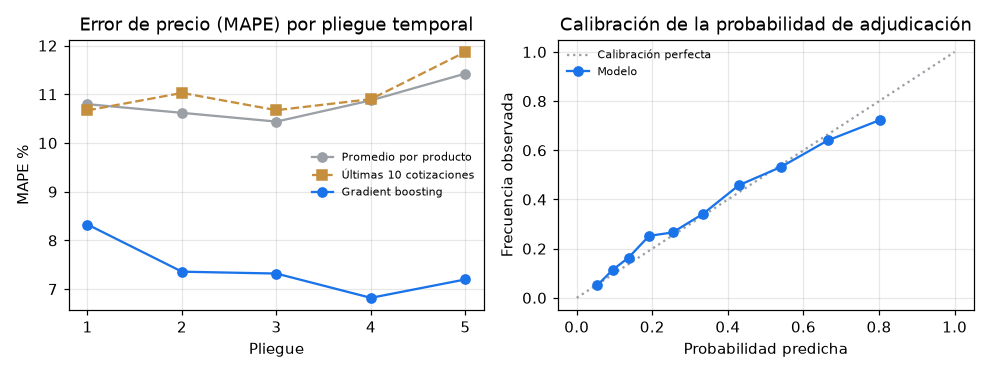

# predictive-quoting-model

Modelo predictivo para **cotizaciones comerciales**: sugiere el precio unitario de cada solicitud, estima la
probabilidad de adjudicación y deja que el ejecutivo **revise solo las cotizaciones de baja confianza**. Es
una recreación, con datos 100 % sintéticos, de una solución que diseñé para una empresa de dispositivos
médicos, donde redujo en un 60 % el tiempo diario dedicado a cotizar.

> Este repositorio no contiene código, datos ni nombres de ningún cliente. Los productos, los clientes y los
> precios son inventados y se generan con una semilla.

## El problema

Un equipo comercial recibe decenas de solicitudes al día y cotiza a mano precio y plazo: busca el historial
del producto, ajusta por cantidad, tipo de cliente, región y urgencia, y redacta. Casi todo ese tiempo se va
en casos rutinarios que se cotizan igual que la vez anterior, mientras los casos difíciles, como
licitaciones, implantes o clientes nuevos, reciben la misma atención que los demás.

## La solución

```text
solicitud ──► atributos (producto, familia, cantidad, cliente, región, canal, urgencia, lista, historial)
                 │
                 ├─► precio sugerido (gradient boosting en log) + intervalo P10–P90 conformal
                 └─► probabilidad de adjudicación (gradient boosting, con descuento y plazo)
                                   │
                         enrutamiento por confianza
                 ├─ auto-sugerida: intervalo estrecho (≤ 20 % del precio) y monto ≤ tope
                 └─ revisión: intervalo ancho o monto alto ──► el ejecutivo parte de la sugerencia
```

- **Datos sintéticos** (`data.py`): 6.000 solicitudes en 24 meses, 40 productos en 5 familias. El precio
  tiene relaciones no lineales: descuento por volumen que se satura, recargo logístico por región que pesa
  más en equipos voluminosos, interacción entre distribuidor y pedido grande, licitaciones más agresivas,
  inflación y estacionalidad. El ruido de negociación es **heterocedástico**: las licitaciones, los
  implantes y los clientes nuevos se negocian caso a caso. La adjudicación depende del descuento (con
  saturación), del plazo castigado por la urgencia, del canal y de la relación con el cliente.
- **Líneas base** (`model.py`): precio promedio por producto, como haría una planilla, y el promedio de
  las últimas 10 cotizaciones del producto. Para la adjudicación, una regresión logística con descuento y
  plazo.
- **Modelo** (`model.py`): `HistGradientBoostingRegressor` sobre el logaritmo del precio, con árboles poco
  profundos. El intervalo P10–P90 sale de regresión cuantílica con **calibración conformal** (CQR): sin
  ella, los cuantiles cubrían solo un 68,1 % de los casos en la misma validación. La probabilidad de adjudicación usa
  `HistGradientBoostingClassifier` regularizado.
- **Validación temporal** (`evaluate.py`): `TimeSeriesSplit` de 5 pliegues. Siempre se entrena con el
  pasado y se evalúa con el futuro; el historial de precios usa solo cotizaciones anteriores.
- **Simulación de tiempo** (`evaluate.py`): aplica el enrutamiento a las predicciones fuera de muestra y
  calcula los minutos diarios antes y después con supuestos explícitos.

## Resultados medidos

Corrida por defecto (`--n 6000 --seed 42`). Las métricas son el promedio de 5 pliegues temporales, con
1.000 solicitudes de prueba por pliegue.

**Precio unitario sugerido**

| Métrica | Promedio por producto | Últimas 10 cotizaciones | Gradient boosting |
|---|---:|---:|---:|
| MAPE | 10,8 % | 11,0 % | **7,4 %** (± 0,6 %) |
| MAE (CLP) | 35.775 | — | **25.788** |
| Cobertura real del intervalo P10–P90 (objetivo: 80 %) | — | — | 78,3 % |

**Probabilidad de adjudicación** (tasa histórica: 35,0 %)

| Métrica | Logística (descuento + plazo) | Gradient boosting | Techo del generador |
|---|---:|---:|---:|
| AUC | 0,775 | 0,776 | 0,797 |
| Brier | 0,182 | 0,183 | — |
| Error de calibración (ECE) | 0,042 | 0,049 | — |

El techo es el AUC de la probabilidad real con la que se generaron los datos, sin el ruido no observado.
Solo se puede calcular porque los datos son sintéticos. El resultado honesto es que **el boosting no le
gana a una logística simple en adjudicación**: casi toda la señal está en el descuento y el plazo, y ambos
modelos quedan a unas 2 centésimas del techo. Los dos están razonablemente calibrados (figura). En un
caso real, esto indica empezar por el modelo simple y explicable.

**Enrutamiento y tiempo** (predicciones fuera de muestra de los 5 pliegues: 5.000 solicitudes)

| Umbral del intervalo | Auto-sugeridas | MAPE auto-sugeridas | MAPE revisión | Auto-sugeridas con error > 10 % | Reducción de tiempo simulada |
|---:|---:|---:|---:|---:|---:|
| 15 % | 12,7 % | 5,7 % | 7,6 % | 14,0 % | 32,4 % |
| **20 %** (por defecto) | **27,5 %** | **5,7 %** | **8,0 %** | **15,4 %** | **41,1 %** |
| 25 % | 50,8 % | 6,1 % | 8,7 % | 18,0 % | 54,6 % |
| 30 % | 71,6 % | 6,5 % | 9,6 % | 21,0 % | 66,8 % |
| 40 % | 92,2 % | 7,2 % | 10,4 % | 24,7 % | 78,8 % |

La reducción de tiempo **no es una medición**: depende de estos supuestos, que están en `Supuestos`
(`evaluate.py`) y se deben reemplazar por los de cada equipo:

| Supuesto | Valor |
|---|---:|
| Solicitudes por día | 40 |
| Cotización manual completa | 12 min |
| Validar una sugerencia de alta confianza | 2 min |
| Revisar una cotización de baja confianza, partiendo de la sugerencia | 9 min |
| Monto total sobre el que siempre revisa una persona | CLP 20.000.000 |

Con el umbral por defecto, el día pasa de 480 a 283 minutos simulados. La tabla muestra la decisión que
hay que tomar con el negocio: subir el umbral ahorra más tiempo, pero también deja pasar más sugerencias
con un error mayor al 10 %.



## Cómo usarlo

```bash
python3 -m venv .venv
.venv/bin/pip install -r requirements.txt

PYTHONPATH=src .venv/bin/python -m quoting                 # 6.000 solicitudes, semilla 42
PYTHONPATH=src .venv/bin/python -m quoting --umbral 0.25   # otro umbral de confianza
PYTHONPATH=src .venv/bin/python -m quoting --n 3000 --seed 7 --splits 4

.venv/bin/python -m unittest discover -s tests
```

La corrida deja en `output/` el dataset sintético, las métricas por pliegue, las predicciones fuera de
muestra y `metricas.json`, y actualiza la figura en `docs/resultados.png`.

## Qué llevé a producción en el caso real

- Una solución predictiva que sugería precio y plazo a partir del historial de cotizaciones y adjudicaciones.
- Revisión del ejecutivo enfocada en los casos de baja confianza, en lugar de cotizar todo desde cero.
- Resultado: **60 % menos tiempo diario de cotización**. Esa cifra es del caso real; las de este
  repositorio salen solo de datos sintéticos y supuestos declarados.

## Limitaciones

- Los datos son sintéticos: las relaciones las definí yo, así que el modelo aprende una estructura que
  existe por construcción. En datos reales hay que revisar la fuga de información, los cambios de lista de
  precios y la calidad del registro de cotizaciones perdidas.
- La probabilidad de adjudicación se evalúa con el precio que efectivamente se cotizó. Usarla para elegir
  el precio óptimo exige razonar en forma causal (descuento → adjudicación) y validarlo con experimentos.
- El intervalo conformal garantiza la cobertura en promedio, no en cada segmento.
- El ahorro de tiempo es una simulación con supuestos; medirlo exige registrar tiempos antes y después.

## Stack

Python 3.10+ · numpy · pandas · scikit-learn · matplotlib · unittest

---

**Nicolás González Rojas** · Head of Data & BI · [LinkedIn](https://www.linkedin.com/in/nicolas-gonzalez-rojas)

> **Nota de rendimiento:** en equipos con muchos núcleos, fijar `OMP_NUM_THREADS=4` evita la sobrecarga de hilos de scikit-learn (en las pruebas, la corrida bajó de ~94 s a ~7 s).
